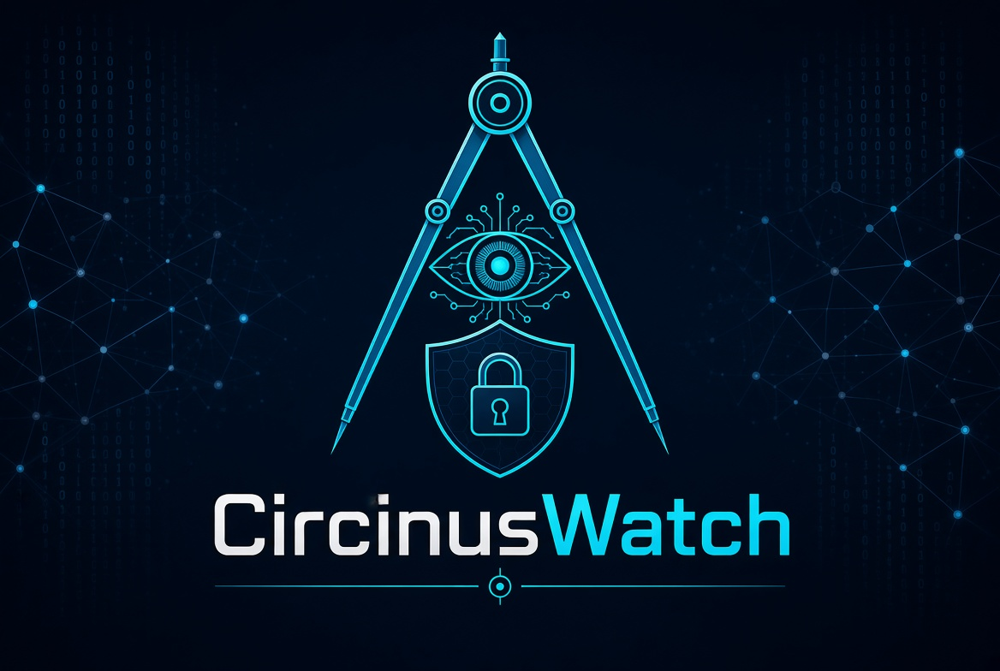

# 🌀 CircinusWatch v8.0


<p align="center">
  
</p>

<p align="center">
  
  
  
  
</p>

<p align="center">
  
  
  
</p>

<p align="center">
  
  
  
</p>

<p align="center">
  
  
  
</p>

<p align="center">
  
  
  
  
</p>

<p align="center">
  
  
  
</p>

<p align="center">
  
  
</p>

<p align="center">
  
  
</p>

<p align="center">
  
</p>

<p align="center">
  
</p>

<p align="center">
  
</p>

**Passive OSINT & Web Security Audit**

Herramienta defensiva de reconocimiento pasivo y auditoría de seguridad web. Recopila información de fuentes públicas, audita cabeceras/TLS/cookies, extrae IOCs y correlaciona técnicas MITRE ATT&CK — todo sin generar tráfico intrusivo contra el objetivo.

> ⚠️ **Uso responsable.** Lee [DISCLAIMER.md](DISCLAIMER.md) antes de usar esta herramienta.

---

## ✨ Características

- 🕵 **OSINT pasivo** — WHOIS, DNS (MX/SPF/DMARC), crt.sh, Wayback, favicon hash, geolocalización IP.
- 🔒 **Auditoría web** — cabeceras de seguridad, TLS/certificado, cookies, divulgación de versión.
- 🦠 **Detección de firmas** — patrones de malware/obfuscación en HTML (estático, sin ejecución).
- 📌 **Extracción de IOCs** — IPs, dominios, URLs y hashes del contenido público (nunca contactados).
- 🎯 **MITRE ATT&CK** — correlación pasiva de hallazgos.
- 📡 **Threat intel opcional** — VirusTotal, URLHaus, Google Safe Browsing, AbuseIPDB, GreyNoise, Shodan.
- 🗣 **Análisis narrativo simétrico** — cuenta marcadores de encuadre beligerante/emocional **en todas las direcciones** (prorruso, proucraniano, pro-OTAN, anti-OTAN). **No es un veredicto.**
- 📊 **Dashboard local** — Flask en `127.0.0.1:5000`.
- 📤 **Exportación** — JSON, reportes y STIX 2.1.
- 👁 **Watchlist** — vigilancia periódica con alertas por Telegram (solo riesgo **técnico**).
- 🧱 **Hardening** — anti-SSRF, descarga acotada, logs atómicos, redacción de secretos.

---

## ⚖️ Principios éticos

1. **100% pasivo.** Sin escaneo activo de puertos (solo índice Shodan). Sin explotación.
2. **Sin juicios de bando.** El análisis narrativo es **simétrico** y cuenta marcadores en todas las direcciones.
3. **Sin geolocalización como señal de peligro.** La ubicación de un servidor no determina su riesgo.
4. **Separación de métricas.** `risk_score` = técnico. `narrative` = informativo. Nunca se mezclan.
5. **Sin claves en el código.** Solo `config.json` (chmod 600) o variables de entorno.

---

## 📦 Instalación

### Requisitos

- Python 3.9+
- pip

### Instalación

```bash
git clone https://github.com/Condor2026/circinuswatch.git
cd circinuswatch
pip install --break-system-packages -r requirements.txt
```

### Dependencias opcionales

```bash
pip install --break-system-packages dnspython mmh3
```

### Configuración de API keys (opcional)

Copia `config.example.json` a `config.json` y rellena lo que tengas:

```bash
cp config.example.json config.json
chmod 600 config.json
```

O usa variables de entorno:

```bash
export VT_API_KEY="..."
export SHODAN_API_KEY="..."
```

**APIs soportadas:**

| Variable | Servicio | Gratis | Notas |
|---|---|---|---|
| `VT_API_KEY` | VirusTotal | Sí (limitado) | virustotal.com |
| `GSB_API_KEY` | Google Safe Browsing | Sí | developers.google.com/safe-browsing |
| `URLHAUS_AUTH_KEY` | URLHaus (abuse.ch) | Sí | Requiere Auth-Key desde 2024 |
| `ABUSEIPDB_API_KEY` | AbuseIPDB | Sí (limitado) | abuseipdb.com |
| `GREYNOISE_API_KEY` | GreyNoise | Sí (community) | greynoise.io |
| `SHODAN_API_KEY` | Shodan | Sí (limitado) | shodan.io |
| `TELEGRAM_BOT_TOKEN` | Telegram | Sí | Para alertas |
| `TELEGRAM_CHAT_ID` | Telegram | Sí | Para alertas |

### Ejecución

```bash
python3 CircinusOsint.py
```

Para permitir objetivos en redes privadas (solo laboratorio propio):

```bash
export CIRCINUS_ALLOW_PRIVATE=1
```

---

## 🖥 Uso

Menú interactivo con 12 opciones:

1. **Escanear objetivo** — flujo completo.
2. **Dashboard web** — Flask en localhost.
3. **Ver logs** — historial.
4. **Escaneo masivo** — lote de hasta 50 dominios.
5. **Estadísticas** — métricas.
6. **Limpiar logs**.
7. **Gestión de listas** — blacklist/whitelist.
8. **Backup**.
9. **Exportar reporte** — JSON.
10. **OSINT extra** — solo fuentes pasivas.
11. **Vigilancia periódica** — watchlist.
12. **Exportar STIX** — bundle 2.1.

---

## 🧱 Hardening aplicado

| Etiqueta | Qué hace |
|---|---|
| Anti-SSRF | Valida objetivo + cada redirección antes de seguir. Bloquea IPs no públicas. |
| Descarga acotada | `MAX_BODY_BYTES` = 2 MB por página. |
| Redacción de secretos | API keys nunca aparecen en logs/errores. |
| Escritura atómica | JSON con `os.replace` + lock. No se corrompen. |
| `config.json` 600 | Permisos estrictos por defecto. |
| Cabeceras case-insensitive | `CaseInsensitiveDict` para HTTP/2. |
| `Text()` en Rich | Datos remotos nunca se interpretan como markup. |
| MITRE corregido | 'ofuscaci'/'obfuscaci' cubre español e inglés. |
| IOCs regex arreglada | Antes lanzaba `re.error` silenciado. |

---

## 🗣 Sobre el análisis narrativo

El módulo detecta **marcadores lingüísticos** de encuadre beligerante. **NO determina veracidad, intención ni bando.** Un texto con muchos marcadores puede ser periodismo crítico legítimo. Los resultados **requieren revisión humana**.

Salida típica:

```json
{
  "total_markers": 7,
  "categories": {"dehumanizacion": 2, "belicismo": 3, "desinformacion": 2},
  "balance": {"pro_ru": 1, "pro_ua": 2, "pro_otan": 1, "anti_otan": 1},
  "framing_intensity": 0.42,
  "disclaimer": "..."
}
```

---

## 📄 Licencia

MIT — ver [LICENSE](LICENSE).

---

## 👤 Autor

**Condor2026** — https://github.com/Condor2026
